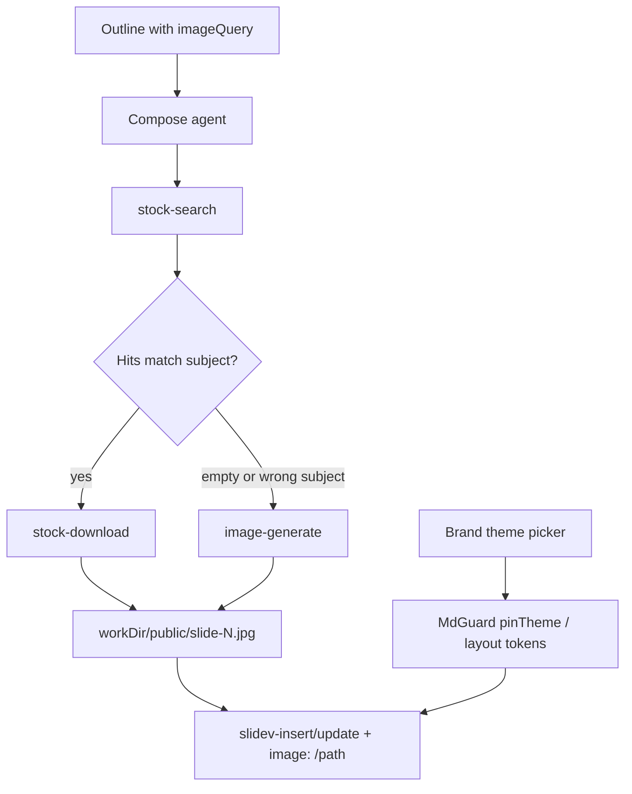

# feat: Image gen fallback + brand themes + denser decks

## Goal Capsule

**Objective:** Pokazo decks on a specific subject (e.g. УАЗ Патриот) look subject-true and brand-coherent: photos match the topic, theme fits the object, slides carry concrete facts — closing the visual gap vs Slaida-class decks.

**Means:** Extend the existing in-process compose tool surface (Unsplash stock) with OpenAI image generation (`gpt-image-1-mini`, low quality); the compose model judges Unsplash relevance from richer hit metadata and generates when stock is empty or not-the-subject; add layout token “brand themes” and denser outline/compose rules — stay on Slidev, do not clone Slaida HTML.

**Authority:** Session-settled product choices below > this plan > prior rich-compose design (AI gen was out of scope — this plan supersedes that ban for deck images).

**Stop when:** A generate-smoke deck for a distinctive subject uses ≥1 generated image when stock is off-topic, brand theme is selectable/pinned, and Vitest covers stock relevance fields + generate tool + compose prompt contracts.

## Product Contract

### Summary

Image pipeline: Unsplash first, generate on low relevance; brand themes for slide layouts; denser factual compose. Same Slidev MCP compose loop.

### Problem Frame

Live comparison: Slaida UAZ deck (brand dark+red, real Patriot imagery, data tables) vs Pokazo UAZ deck (cream AI-default, wrong cars: Niva/Santa Fe/Escalade, vague copy). Stock-only Unsplash cannot guarantee subject match; prior design forbade AI images.

### Requirements

- R1. Compose can search Unsplash and download local `image:` paths under `workDir/public/` (existing).
- R2. `stock-search` returns enough text metadata (description / alt / tags) for the model to judge subject relevance.
- R3. When search is empty or hits are not the subject, compose may call an image-generate tool that writes a local file and returns a Slidev `image:` path.
- R4. Image generation uses OpenAI Images API with a cheap model: default `gpt-image-1-mini`, `quality: low`, landscape size; model id overridable via env.
- R5. The compose model decides stock vs generate — no hard-coded classifier service; prompts + tool descriptions encode the policy.
- R6. Generated and stock images remain local-only after MdGuard (no remote URLs in decks).
- R7. Brand themes: selectable palette/token packs for Pokazo layouts (beyond stock Slidev theme packages), including a dark+accent “automotive/editorial” option; pinned in headmatter like today’s theme.
- R8. Denser decks: outline/compose push concrete facts, kickers, sources, comparison/stats layouts — not only short marketing bullets.
- R9. Attributions/trace record whether an asset came from Unsplash or OpenAI generate (for debugging and future licensing notes).

### Key Decisions

- KD1. Provider = OpenAI Images, cheap tier only (`gpt-image-1-mini` + low quality). Governs R4. Chosen over YandexART / Flux / gpt-image-2 high.
- KD2. Relevance = model judgment on low-relevance / wrong-subject hits, not a numeric embedding scorer. Governs R3, R5.
- KD3. Full quality package in this plan: images + brand themes + denser content. Governs R7, R8.
- KD4. Tool surface stays in-process AI SDK tools (same as stock), not a separate stdio MCP process — “MCP” here means tools exposed to the compose agent. Governs R3. Chosen over new stdio server.
- KD5. Stay on Slidev + custom layouts; do not migrate to Slaida-style per-slide HTML design system in this plan. Governs R7.

### Actors

- A1. Deck author (end user) — picks theme, topics; sees better photos/content.
- A2. Compose agent (LLM + tools) — searches, judges, generates, inserts slides.
- A3. Operator — configures `UNSPLASH_ACCESS_KEY`, `OPENAI_API_KEY`, optional model overrides.

### Key Flows

- F1. Photo slide: outline `imageQuery` → `stock-search` → model judges hits → `stock-download` OR `image-generate` → insert/update with `image: /slide-N.jpg`.
- F2. Theme pick: user selects brand theme → MdGuard pins → layouts use CSS token pack.
- F3. Dense slide: outline carries facts/stats/source → compose uses timeline/stats/two-cols (or table-friendly markdown) instead of empty bullets.

### Acceptance Examples

- AE1. Topic “УАЗ Патриот 2026”: if Unsplash returns Niva/Hyundai-like mismatches (descriptions don’t match Patriot), compose generates and deck frontmatter uses a generated local path on ≥1 photo slide.
- AE2. With Unsplash key missing but OpenAI key present: photo slides still get local images via generate (or clear tool errors + non-photo layouts — must not silently leave blank white cards).
- AE3. Picker includes a dark brand theme; built deck layouts show dark paper + accent, not only cream `#f7f3ec`.
- AE4. At least one slide in a factual topic deck has a source line or comparison/stats structure (not only 3 marketing bullets).

### Scope Boundaries

**In scope**

- `assets-stock` richer metadata; `image-generate` client + tools; env; compose/outline prompts; theme token packs + picker sync; tests.

**Out of scope / deferred**

- Slaida HTML `theme.css` / per-slide design template engine.
- Embedding-based relevance scoring service.
- Expensive OpenAI image models / high quality by default.
- AI video; editing/inpainting pipelines.
- Changing the web player chrome (only slide content quality).

**Deferred to Follow-Up Work**

- Cost caps / per-deck generate budget hard limits in product UI.
- Migration when `gpt-image-1-mini` is retired (env model id already mitigates).

### Success Criteria

- Subject-true images on photo-heavy decks for distinctive topics.
- Brand theme visibly different from cream default.
- Vitest green for new modules; compose-skill tests assert generate-fallback policy text.
- Optional smoke: one live generate against OpenAI (manual / scripted, not required in CI without key).

## Planning Contract

### Key Technical Decisions

- KTD1. Reuse `safePublicPath` + write under `workDir/public/`; prefer `slide-N-gen.png` (or `.jpg` if API returns JPEG) for generated files. session-settled: KD4 in-process tools.
- KTD2. Enrich `StockHit` with `description` and `altDescription` from Unsplash API; return them from `stock-search` so the model can reject wrong subjects. session-settled: KD2.
- KTD3. New module `assets-openai-image.ts` + `createImageGenTools` in `assets-tools.ts` (or sibling `assets-gen-tools.ts`) merged via existing `mergeComposeTools` in `generate.ts`. Default model `gpt-image-1-mini`, `quality: "low"`, size `1536x1024`. Env: `OPENAI_API_KEY`, `OPENAI_IMAGE_MODEL` (override).
- KTD4. Brand themes v1 = CSS variable packs on `pk-brick` layouts (shared tokens file or data attribute), plus picker entries synced in `themes.ts` / `apps/web/src/decks.ts`. Prefer extending layout tokens over publishing a full `@slidev/theme-*` package in v1. Wire unused `brand` prop on `hero.vue` where useful.
- KTD5. Density: tighten outline prompts + `outline-plan` rules (require `source` / concrete numbers on stats/comparison-intent slides); extend compose-skill for comparison tables in markdown where layout allows; do not raise bullet max above 5 without cause — prefer stats/timeline payloads.
- KTD6. Trace: extend `assets.json` / attributions with `source: "unsplash" | "openai"` and prompt/query fields.
- KTD7. Cost: never default to high quality; document ~$0.005–0.006/image low tier; generate only after failed/low-relevance stock for that slide (prompt-enforced).

### Assumptions

- OpenAI Images generations endpoint returns b64 or URL that we download into `public/` (same trust boundary as Unsplash download).
- OpenRouter key remains for LLM compose; image gen needs a separate OpenAI key (or documented compatible base URL).
- “Low relevance” will be imperfect; wrong generates are acceptable vs wrong stock cars for v1.
- Pack discovery: no CE packs configured (`roots: []`).

### High-Level Technical Design



```text
tools = merge(
  slidev MCP whitelist,
  createStockTools(workDir),      // enriched metadata
  createImageGenTools(workDir)    // openai cheap
)
```

### Sequencing

U1 → U2 → U3 → U4 (images path) in parallel with U5 after U1 patterns known; U6 can follow U4; U7 last.

### Risks

| Risk | Mitigation |
|------|------------|
| `gpt-image-1-mini` deprecation | Env `OPENAI_IMAGE_MODEL`; prefer low-cost successor later |
| Model downloads wrong stock anyway | Richer descriptions + strong compose skill; AE1 smoke |
| Cost blowups | low quality; generate only on fallback; optional later budget |
| Layout brand vs Slidev theme clash | Token packs on `pk-brick` dominate visual; Slidev theme secondary |
| No OpenAI key in CI | Unit tests mock fetch; live smoke optional |

### Patterns to Follow

- `apps/api/src/assets-tools.ts` factory + injectable deps + Vitest mocks
- `apps/api/src/compose-skill.test.ts` prompt contract tests
- `apps/api/src/md-guard.ts` local image allowlist
- Prior design/plan: `docs/superpowers/specs/2026-10-05-rich-compose-stock-assets-design.md` (AI gen ban superseded for this track)

## Implementation Units

### U1. Enrich Unsplash hits for relevance judgment

**Goal:** Compose can see what a photo depicts before downloading.

**Approach:** Extend `StockHit` + Unsplash mapping with `description` / `altDescription`; include in `stock-search` return; update tool description to require rejecting wrong-subject hits.

**Files:** `apps/api/src/assets-stock.ts`, `apps/api/src/assets-stock.test.ts`, `apps/api/src/assets-tools.ts`, `apps/api/src/assets-tools.test.ts`

**Requirements:** R2, R5 — KTD2

**Test scenarios:**

- Happy: mock Unsplash JSON with `description` / `alt_description` → hit fields populated and returned from tool.
- Edge: missing description fields → empty strings, tool still returns ids.
- Error: non-OK Unsplash → structured error object (prefer not throw) so compose can fall through to generate.

**Execution note:** TDD — failing tests first.

### U2. OpenAI image generate client

**Goal:** Cheap OpenAI image → bytes on disk under `public/`.

**Approach:** `generateOpenAiImageToPublic({ workDir, prompt, filename, apiKey, model, quality, size, fetchImpl })` using Images API; write via `safePublicPath`; return path + attribution stub (`source: openai`).

**Files:** `apps/api/src/assets-openai-image.ts`, `apps/api/src/assets-openai-image.test.ts`, `apps/api/src/env.ts`, `.env.example`

**Requirements:** R3, R4, R6, R9 — KTD1, KTD3

**Test scenarios:**

- Happy: mock API b64 → file exists under `public/`, path basename safe.
- Edge: unsafe filename rejected by `safePublicPath`.
- Error: missing API key / non-OK response → thrown or result error (match stock style chosen in U3).
- Defaults: model `gpt-image-1-mini`, quality `low` unless overridden.

### U3. Wire `image-generate` tool into compose

**Goal:** Compose agent can call generate like stock-download.

**Approach:** `createImageGenTools` → `image-generate` (prompt, filename); merge in `generate.ts` with stock tools; attributions callback with `source: "openai"`.

**Files:** `apps/api/src/assets-tools.ts` or `assets-gen-tools.ts`, `apps/api/src/generate.ts`, `apps/api/src/generate-helpers.ts` (if merge helper needs update), tests

**Requirements:** R3, R5, R9 — KTD3, KTD6

**Test scenarios:**

- Happy: tool execute with mock generate → `{ path: "/slide-2-gen.png" }` shape usable in frontmatter.
- Edge: no `OPENAI_API_KEY` → clear error payload (tools still registered, like stock).
- Integration: `mergeComposeTools` includes both stock and generate tool names.

### U4. Compose / outline policy for stock → generate fallback

**Goal:** Prompts encode “not the subject → generate”.

**Approach:** Update `composeSkill` / `composeUserPrompt` / outline imageQuery guidance: use search metadata; if empty or wrong subject, `image-generate` with a precise English prompt that names the subject; still require ≥3 local images; never remote URLs. Revise prior “AI gen forbidden” docs in a short note in this plan’s origin (no need to rewrite entire old design unless conflicting lines block implementers — add supersession note in compose-skill comments or design header if touched).

**Files:** `apps/api/src/compose-skill.ts`, `apps/api/src/compose-skill.test.ts`, optionally `outline` prompt strings in same file / `outline-plan.ts`

**Requirements:** R3, R5, R8 — session-settled KD2

**Test scenarios:**

- Prompt contains `image-generate` and relevance/fallback language.
- Prompt still forbids `http(s)` image URLs.
- Prompt still requires ≥3 local images.
- Does not instruct to use expensive/high quality.

### U5. Brand theme token packs + picker

**Goal:** Decks can look dark+accent (editorial/auto), not only cream terracotta layouts.

**Approach:** Extract shared CSS vars for `pk-brick` layouts; add 2–3 named packs (e.g. `cream`, `ink-dark`, `brand-auto`); map picker theme ids or a new `brandTheme` frontmatter key pinned by MdGuard; sync web picker labels/colors. Wire `brand` on hero when outline/kicker provides a short brand string.

**Files:** `apps/api/slidev-layouts/*`, new tokens CSS or shared import, `apps/api/src/themes.ts`, `apps/api/src/themes.test.ts`, `apps/api/src/md-guard.ts`, `apps/web/src/decks.ts`, compose-skill theme/brand lines

**Requirements:** R7 — KTD4

**Test scenarios:**

- Theme sanitize: unknown → safe default; known brand pack id accepted.
- MdGuard pins theme / brand field as designed.
- Layout smoke (unit or snapshot of CSS var presence) optional; at minimum themes registry tests.

**Execution note:** Prefer token packs on existing layouts over new Slidev theme npm package.

### U6. Denser factual outline/compose rules

**Goal:** Fewer empty marketing slides; more stats/timeline/source.

**Approach:** Outline prompts require concrete numbers or named entities for stats/comparison intents; prefer `stats` / `timeline` / `two-cols` for spec topics; require `source` on data-like slides when claiming figures; compose-skill examples for comparison markdown tables where layout is `default`/`two-cols`.

**Files:** `apps/api/src/compose-skill.ts`, `apps/api/src/outline-plan.ts`, `apps/api/src/outline-plan.test.ts`, `compose-skill.test.ts`

**Requirements:** R8 — KTD5 — AE4

**Test scenarios:**

- Outline validator: stats visual without stats payload still rejected (existing) + new source/density rule if added.
- Compose skill text mentions comparison/source expectations.

### U7. Verification harness + optional smoke

**Goal:** Prove the fallback path without relying on prod luck.

**Approach:** Unit coverage from U1–U6; add a focused integration test with mocked Unsplash (wrong-subject descriptions) + mocked OpenAI → compose tools execute path writes gen file; optional script `apps/api/scripts/` for live UAZ-like topic when keys present.

**Files:** new `apps/api/src/assets-pipeline.test.ts` (or extend existing), optional script

**Requirements:** AE1–AE4

**Test scenarios:**

- Mocked pipeline: search returns off-topic description → generate called (simulate agent policy by testing tool layer + prompt contracts; full LLM e2e optional).
- Smoke (manual): document command + expected ≥1 `source: openai` in `assets.json`.

## Verification Contract

```bash
cd apps/api && npm test -- --run assets-stock assets-tools assets-openai-image compose-skill themes outline-plan
```

Optional live (keys required):

```bash
# document exact script once U7 lands
```

MdGuard / health tests if theme pinning changes:

```bash
cd apps/api && npm test -- --run health themes
```

## Definition of Done

- All U1–U7 test scenarios implemented and green in CI without live OpenAI/Unsplash keys.
- Compose skill documents stock → relevance → generate; defaults stay on `gpt-image-1-mini` + low.
- Brand dark theme selectable and visible on `pk-brick` layouts.
- `.env.example` documents `OPENAI_API_KEY` and `OPENAI_IMAGE_MODEL`.
- Prior “no AI image gen” constraint superseded for this pipeline (note in touched design/plan docs if edited).
- No remote image URLs survive MdGuard.

## Appendix

### Session-settled decisions

| Decision | Class | Rejected |
|----------|-------|----------|
| OpenAI cheap image model | product | Expensive OpenAI tiers; Yandex/Flux for v1 |
| Fallback on low relevance / wrong subject | product | Numeric scorer; always-generate |
| Full scope: images + brand + density | product | Images-only first slice |
| Stay on Slidev; in-process tools | planning | Slaida HTML engine; stdio MCP process |

### Evidence

- Slaida sample: dark tokens Oswald/Onest, design templates, real product photo.
- Pokazo sample `283de443-…`: wrong stock subjects; cream layouts; sparse specs.
- Repo research: stock tools implemented; no generate path; `hero.vue` brand prop unused; rich-compose plan checkboxes stale vs code.

### Cost note (external)

OpenAI `gpt-image-1-mini` low quality ~$0.005/image (1024) / ~$0.006 landscape — verify against current OpenAI pricing at implement time.
