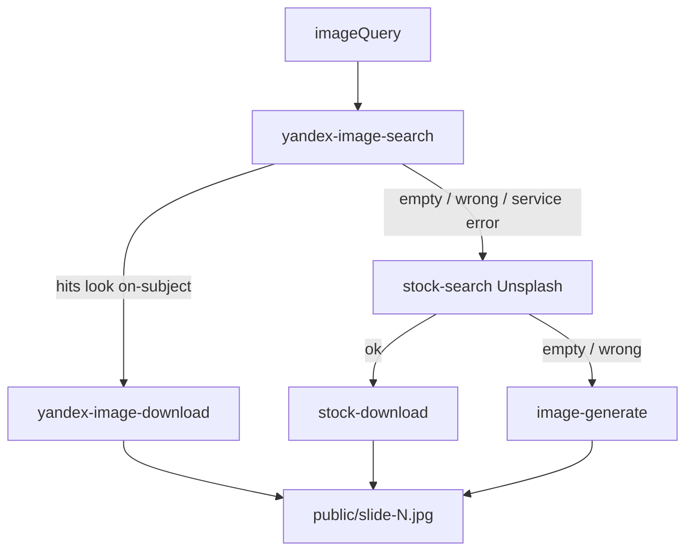

# Design: Yandex Images stock for Pokazo (HTTP service)

Date: 2026-10-08  
Status: approved (session)  
Supersedes for image search order: Unsplash-first policy in rich-compose / image-gen plans — new order is Yandex → Unsplash → generate.

## Problem

Unsplash (compose `stock-search`) often returns subject-wrong photos for Russian topics (e.g. УАЗ Патриот → other cars). Need a Russian-index image search before falling back to Unsplash / OpenAI generate.

## Decisions (session-settled)

| ID | Decision |
|----|----------|
| D1 | Source = Yandex Search API image search (`images-xml` / Yandex Images index) |
| D2 | Architecture = one HTTP search service on VPS; Pokazo calls it over HTTP |
| D3 | **Not** registered in Cursor `mcp.json` — Cursor agents do not use this service |
| D4 | Compose order: **Yandex → Unsplash → image-generate** |
| D5 | Licensing MVP: download into `workDir/public/`; store page URL + image URL in attribution; tighten later |
| D6 | Service exposes a simple REST search API for Pokazo (not MCP JSON-RPC). May live under `~/mcp/servers/` for deploy parity with other VPS tools, but it is a Pokazo backend dependency, not a Cursor MCP |

## Goals

- Photo slides for RU-specific subjects get relevant hits more often than Unsplash alone.
- Same local-only image rule as today: Slidev `image:` paths under `public/` after download.
- Clear degrade path when the Yandex service is down or returns empty/off-topic hits.

## Non-goals

- Cursor MCP wiring / agent tools in IDE.
- Reverse image search.
- Site allowlist / commercial license filtering (post-MVP).
- Replacing OpenAI `image-generate`.
- Changing web player chrome.

## Architecture

```text
compose agent
  → yandex-image-search  → HTTP GET/POST  VPS yandex-images :3021/search
  → judge title / pageUrl / domain
  → yandex-image-download → fetch imageUrl → workDir/public/slide-N.jpg
  → else stock-search (Unsplash) → stock-download
  → else image-generate
```



### Component A — `yandex-images` HTTP service (VPS)

- Location: `~/mcp/servers/yandex-images` (Docker + compose, port **3021**), same ops style as webmaster/wordstat.
- Env: `YANDEX_SEARCH_API_KEY`, `YANDEX_FOLDER_ID`.
- Upstream: Yandex Cloud Search API image search (XML response → JSON).
- Endpoints:
  - `GET /health` — liveness.
  - `POST /search` (or GET with query params) — body/params: `query` (required), `count` (1–10, default 5), `orientation` (`horizontal` \| `vertical` \| `square`, optional), `size` (optional), `familyMode` (optional), `site` (optional), `page` (optional).
- Response JSON:

```json
{
  "query": "УАЗ Патриот",
  "hits": [
    {
      "id": "stable-hash-or-cbir",
      "title": "...",
      "imageUrl": "https://...",
      "thumbUrl": "https://...",
      "pageUrl": "https://...",
      "width": 1600,
      "height": 900,
      "domain": "uaz.ru"
    }
  ]
}
```

- Errors: non-2xx with `{ "error": "..." }`; Pokazo treats any failure as “skip to Unsplash”.
- Auth between Pokazo and service: optional shared bearer later; MVP = private VPS network / not public-indexed (same trust as other internal MCP HTTP ports). No Cursor config.

### Component B — Pokazo API client + tools

- Config (`env.ts`):
  - `YANDEX_IMAGES_URL` — base URL, e.g. `http://91.207.75.72:3021` (empty = feature off).
  - Reuse existing keys only on the **service** side; Pokazo does not call `images-xml` directly in this design (D2).
- Module: `apps/api/src/assets-yandex.ts` — `searchYandexImages`, `downloadYandexImageToPublic` (reuse `safePublicPath` from `assets-stock.ts`).
- Tools (AI SDK), merged in `generate.ts` beside stock + image-gen:
  - `yandex-image-search` — calls service `/search`; caches hits by id in-process for download.
  - `yandex-image-download` — downloads `imageUrl` to `public/`, records attribution.
- Attribution / `assets.json` trace: `source: "yandex" | "unsplash" | "openai"`; for yandex include `pageUrl`, `imageUrl`, `title`, `query`.

### Component C — Compose policy

- Update `compose-skill.ts` (and any outline/imageQuery hints): for photo slides, **prefer Russian/natural query for Yandex first**; Unsplash still English-oriented as second step; then generate.
- Tool descriptions must encode order: try yandex → if empty/wrong/error → Unsplash → if empty/wrong → `image-generate`.
- Relevance = model judgment on title/domain/pageUrl (same philosophy as Unsplash description/alt).

## Error handling

| Case | Behavior |
|------|----------|
| `YANDEX_IMAGES_URL` empty | Tools return clear error; skill skips to Unsplash |
| Service timeout / 5xx | Skip to Unsplash |
| Empty hits | Skip to Unsplash |
| Download fail (hotlink/403) | Retry once other hit id, else Unsplash/generate |
| Unsplash also bad | `image-generate` (existing) |

Default timeout for search/download: ~15s (align with Unsplash).

## Testing

- Unit: XML/JSON mapper (service) or fixture-based client parser if mapper lives in Pokazo tests via mocked `fetch`.
- Pokazo Vitest: `yandex-image-search` / download tools with mocked `YANDEX_IMAGES_URL` fetch; compose-skill text asserts Yandex-first order.
- Optional manual smoke: query `УАЗ Патриот` against live service after deploy.

## Rollout

1. Deploy `yandex-images` on VPS `:3021`.
2. Set `YANDEX_IMAGES_URL` on Pokazo API.
3. Ship Pokazo tools + compose-skill.
4. Smoke one RU subject deck.

## Open risks

- Web hotlink blocks on some `imageUrl` hosts — mitigated by trying another hit / fallback.
- Copyright: MVP attribution only (D5); product copy should not claim Unsplash-like license for Yandex hits.
- Service outage must not break decks — degrade path is mandatory.
`}